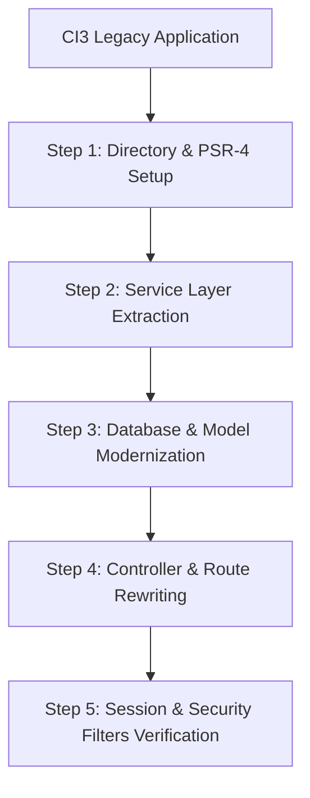

# CodeIgniter 3 to CodeIgniter 4 Upgrader Skill

Migrating from CodeIgniter 3 to 4 represents a shift from legacy PHP 5/7 procedural-oriented OOP to modern PSR-4 namespaced architecture. This skill provides an automated and structured method to execute the migration without losing business logic.

---

## Key Differences & Architecture Mapping

| Feature | CodeIgniter 3 | CodeIgniter 4 |
|---|---|---|
| **PHP Requirement** | PHP 5.6 - 7.x | PHP 8.1 - 8.4+ |
| **Namespaces** | None (Global classes) | Full PSR-4 (`App\Controllers`, `App\Models`) |
| **Super Object** | `$this->load->...` | Dependency Injection & Services (`Services::request()`) |
| **Web Root** | Index file at root directory | `public/index.php` (Essential for security) |
| **Configuration** | `application/config/*.php` | `app/Config/*.php` (Typed classes) & `.env` |
| **Hooks** | CI Hooks (`application/config/hooks.php`) | Filters (`App\Filters\FilterInterface`) |
| **Input / Request** | `$this->input->post('key')` | `$this->request->getPost('key')` |
| **Database** | `$this->db->get('table')` | `$db->table('table')->get()` or Models |

---

## Step-by-Step Modernization Strategy



### Step 1: Set Up CI4 Directory Structure & Autoloading
1. Move the legacy code into an isolated folder (e.g. `legacy_ci3/`).
2. Scaffold a fresh CI4 layout:
   ```bash
   composer create-project codeigniter4/appstarter modern_ci4
   ```
3. Configure `app/Config/Autoload.php` to register custom namespaces for legacy helper/library packages if transitional compatibility is required.

---

### Step 2: Database Layer Migration

#### CI3 Model:
```php
class User_model extends CI_Model {
    public function get_user($id) {
        $query = $this->db->get_where('users', array('id' => $id));
        return $query->row_array();
    }
}
```

#### CI4 Model:
```php
namespace App\Models;

use CodeIgniter\Model;

class UserModel extends Model {
    protected $table = 'users';
    protected $primaryKey = 'id';
    protected $allowedFields = ['name', 'email', 'status'];
    protected $returnType = 'array';

    public function getUser(int $id): ?array {
        return $this->find($id);
    }
}
```

---

### Step 3: Controller Refactoring

#### CI3 Controller:
```php
class Users extends CI_Controller {
    public function __construct() {
        parent::__construct();
        $this->load->model('User_model');
    }

    public function view($id) {
        $data['user'] = $this->User_model->get_user($id);
        $this->load->view('users/view', $data);
    }
}
```

#### CI4 Controller:
```php
namespace App\Controllers;

use App\Models\UserModel;

class Users extends BaseController {
    private UserModel $userModel;

    public function __construct() {
        $this->userModel = new UserModel();
    }

    public function view(int $id): string {
        $data['user'] = $this->userModel->getUser($id);
        if (!$data['user']) {
            throw \CodeIgniter\Exceptions\PageNotFoundException::forPageNotFound();
        }
        return view('users/view', $data);
    }
}
```

---

### Step 4: Run the Migration Tool

Run the automated [CI3 to CI4 AST Migrator Script](./scripts/ci3-to-ci4-migrator.php):

```bash
php .agents/skills/codeigniter-upgrader/scripts/ci3-to-ci4-migrator.php --src=legacy_ci3/application --dest=modern_ci4/app
```
