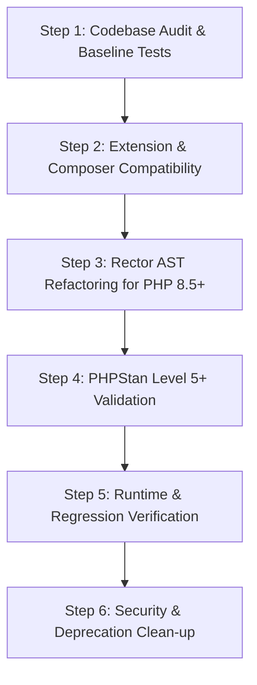

# PHP Core Upgrader Skill (Legacy -> PHP 8.5+ & Latest)

This skill guides the automated, non-destructive migration of legacy PHP applications to **PHP 8.5.12+ and upcoming releases**.

## Core Principles & Anti-Obsolescence Guarantees

1. **Non-destructive AST-based Migration**: Use Rector and PHPStan with dynamic version resolution to safely refactor syntax and type declarations without altering business logic.
2. **Stepwise Version Transitions**: If migrating from PHP 5.6 or 7.x, adhere to the staged transition path: `5.6 -> 7.4 -> 8.0 -> 8.2 -> 8.3 -> 8.4 -> 8.5+`.
3. **Continuous Forward Compatibility**: Automatically detects the host runtime (e.g. PHP 8.5.12) to ensure rules and type declarations remain modern and do not deprecate.
4. **Zero Untested Jumps**: Execute tests before and after every version step.

---

## Upgrade Workflow



### Step 1: Baseline Audit & Test Verification

Before any code modifications:
1. Verify Composer configuration and check for direct `php` constraint:
   ```bash
   composer check-platform-reqs
   ```
2. Execute existing unit and integration tests:
   ```bash
   vendor/bin/phpunit --no-coverage
   ```
3. If no automated tests exist, run characterization tests or capture HTTP request/response baselines on key API endpoints.

---

### Step 2: Critical PHP 8.0 - 8.5+ Breaking Changes Checklist

Review [PHP Breaking Changes Reference](./references/php-breaking-changes.md) for full details:

| PHP Version | Breaking Change | Safe Mitigation |
|---|---|---|
| **PHP 8.0** | Undefined array key is `E_WARNING` | Use `$array['key'] ?? $default` or `isset()` |
| **PHP 8.0** | Fatal error on non-callables in `call_user_func` | Guard with `is_callable()` before invocation |
| **PHP 8.0** | String to number comparison changes (`0 == "foobar"` is `false`) | Use strict comparison `===` or explicit casts `(int)` |
| **PHP 8.1** | Passing `null` to non-nullable internal functions throws `TypeError` | Cast with `(string)` or wrap with `?? ''` (e.g., `strlen((string)$str)`) |
| **PHP 8.1** | Return type declaration mismatch in built-in interfaces (`Iterator`, `ArrayAccess`, `JsonSerializable`) | Add `#[\ReturnTypeWillChange]` or declare proper native return type |
| **PHP 8.2** | Dynamic properties are deprecated | Add `#[\AllowDynamicProperties]` to legacy classes or declare properties |
| **PHP 8.2** | `${var}` string interpolation deprecated | Change to `{$var}` syntax |
| **PHP 8.3** | Typed class constants & dynamic class constant fetch | Modernize constant access |
| **PHP 8.4** | Implicitly nullable parameter types deprecated (`function foo(string $bar = null)`) | Modernize to explicit union: `function foo(?string $bar = null)` |
| **PHP 8.5+** | Dynamic property deprecations escalate towards fatal errors | Fully declare properties or inherit from `stdClass` / `#[\AllowDynamicProperties]` |
| **PHP 8.5+** | Stricter method override attributes (`#[Override]`) | Adopt `#[Override]` to ensure parent method signatures remain aligned |

---

### Step 3: Run Automated Rector Refactoring

Execute the pre-configured [Rector Script](./scripts/rector-php-upgrade.php):

```bash
# Dry run first to inspect diffs
vendor/bin/rector process --dry-run --config=.agents/skills/php-core-upgrader/scripts/rector-php-upgrade.php

# Apply changes safely
vendor/bin/rector process --config=.agents/skills/php-core-upgrader/scripts/rector-php-upgrade.php
```

---

### Step 4: Strict Static Analysis with PHPStan

Run PHPStan using the [PHPStan Config](./scripts/phpstan.neon) at incrementally higher levels:

```bash
# Start at level 4 to catch deprecations and fatal type issues
vendor/bin/phpstan analyse -c .agents/skills/php-core-upgrader/scripts/phpstan.neon --level 4

# Escalate to level 6 or 8
vendor/bin/phpstan analyse -c .agents/skills/php-core-upgrader/scripts/phpstan.neon --level 6
```

---

### Step 5: Runtime Verification

Run tests against target PHP runtime (e.g. PHP 8.5.12+):
```bash
php -v
vendor/bin/phpunit
```
Check PHP error logs for any unexpected notices or uncaught warnings.
