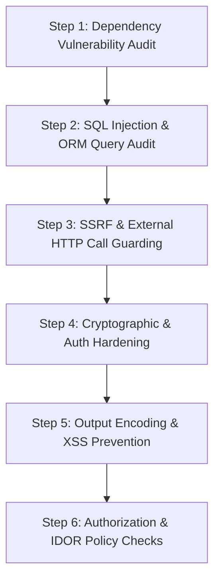

# PHP Security Hardener Skill

This skill delivers automated security checks, code patterns, and verification tests to harden PHP applications during or after a version migration.

---

## Security Scan Workflow



---

## Step 1: Composer Dependency Audit

Modern PHP includes built-in dependency vulnerability auditing. Run:

```bash
composer audit
```

To continuously block packages with known security advisories, require `roave/security-advisories`:

```bash
composer require --dev roave/security-advisories:dev-latest
```

---

## Step 2: SQL Injection Remediation

### Problem
Raw string concatenation in SQL queries allows attackers to extract, modify, or delete database tables.

### Vulnerable Legacy Pattern:
```php
$userId = $_GET['id'];
$result = $pdo->query("SELECT * FROM users WHERE id = " . $userId);
```

### Remediated: Prepared Statements with Parameter Binding
```php
$stmt = $pdo->prepare("SELECT id, name, email FROM users WHERE id = :id");
$stmt->execute(['id' => (int)$userId]);
$user = $stmt->fetch(PDO::FETCH_ASSOC);
```

### In Laravel Eloquent:
Avoid raw queries without bindings. If using `whereRaw()` or `DB::raw()`, always pass parameters separately:
```php
// Unsafe:
User::whereRaw("status = '" . $status . "'")->get();

// Safe:
User::whereRaw("status = ?", [$status])->get();
// Or Eloquent query builder:
User::where('status', $status)->get();
```

---

## Step 3: Server-Side Request Forgery (SSRF) Hardening

### Problem
Fetching user-supplied URLs via `curl` or `file_get_contents` allows attackers to pivot into the internal network, cloud metadata endpoints (`http://169.254.169.254`), or localhost services.

### Safe URL Fetching Implementation:
```php
function safeFetchUrl(string $url): string {
    $parsed = parse_url($url);
    if (!isset($parsed['scheme'], $parsed['host']) || !in_array($parsed['scheme'], ['http', 'https'], true)) {
        throw new InvalidArgumentException('Invalid protocol.');
    }

    $ip = gethostbyname($parsed['host']);
    
    // Disallow private and reserved IP ranges (RFC 1918, loopback, link-local)
    if (!filter_var($ip, FILTER_VALIDATE_IP, FILTER_FLAG_NO_PRIV_RANGE | FILTER_FLAG_NO_RES_RANGE)) {
        throw new SecurityException('Access to private or local network resources is forbidden.');
    }

    $ch = curl_init($url);
    curl_setopt_array($ch, [
        CURLOPT_RETURNTRANSFER => true,
        CURLOPT_FOLLOWLOCATION => false, // Disallow automatic redirects to private IPs
        CURLOPT_TIMEOUT => 5,
        CURLOPT_PROTOCOLS => CURLPROTO_HTTP | CURLPROTO_HTTPS,
    ]);

    $response = curl_exec($ch);
    curl_close($ch);
    return (string)$response;
}
```

---

## Step 4: Cryptography & Password Hashing

- **Never use `md5()` or `sha1()` for passwords or sensitive hashes**.
- Use native PHP `password_hash()` with `PASSWORD_BCRYPT` or `PASSWORD_ARGON2ID`:
  ```php
  // Hashing:
  $hash = password_hash($plainPassword, PASSWORD_ARGON2ID);

  // Verification:
  if (password_verify($submittedPassword, $hash)) {
      if (password_needs_rehash($hash, PASSWORD_ARGON2ID)) {
          // Re-hash and save updated hash
      }
  }
  ```
- Generate cryptographically secure tokens using `random_bytes()`:
  ```php
  $csrfToken = bin2hex(random_bytes(32));
  ```
