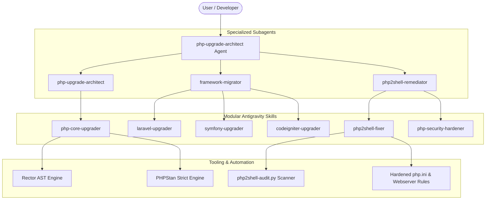

# PHP Upgrade & Modernization Agent Toolkit

A production-grade, battle-tested agentic toolkit and skill suite designed to upgrade legacy PHP applications to the latest PHP version (PHP 8.2, 8.3, 8.4+) and modernize frameworks (**Laravel 8 to 12+**, **Symfony 4.4/5.4 to 6.4/7.x+**, and **CodeIgniter 3 to 4+**) without breaking application core business logic.

Includes automated vulnerability scanning and remediation for the **October 2026 php2shell** remote code execution (RCE) vectors and OWASP Top 10 vulnerabilities.

---

## Architecture Overview



---

## 1. Specialized Autonomous Agents

The toolkit provides three specialized agents ready for invocation via `invoke_subagent`:

| Agent | Role & Capabilities |
|---|---|
| **`php-upgrade-architect`** | Master modernization orchestrator. Audits legacy codebases, checks PHP extension and Composer compatibility, plans staged upgrade paths, configures Rector/PHPStan, and guarantees behavioral parity. |
| **`framework-migrator`** | Framework migration specialist. Manages breaking changes across major version leaps: **Laravel 8 -> 12**, **Symfony 4.4/5.4 -> 7.x**, and **CodeIgniter 3 -> 4**. |
| **`php2shell-remediator`** | Security RCE specialist. Scans, detects, and neutralizes PHP-to-shell exploit chains, the **October 2026 php2shell** attack vectors, stream filter chains, and dynamic execution hazards. |

---

## 2. Comprehensive Skills Catalog

All skills reside in `.agents/skills/` following the Antigravity skill specification:

### [1. php-core-upgrader](./.agents/skills/php-core-upgrader/SKILL.md)
- **Target**: Legacy PHP (5.6, 7.0-7.4, 8.0, 8.1, 8.2) to PHP 8.3 / 8.4+.
- **Key Mitigations**:
  - Deprecated dynamic properties: Automates `#[\AllowDynamicProperties]` bridge or explicit typed properties.
  - Undefined array keys & variables: Null-coalescing and `isset()` safety transforms.
  - Type strictness: `#[\ReturnTypeWillChange]` on core interfaces (`Iterator`, `ArrayAccess`, `JsonSerializable`).
  - PHP 8.4 parameter nullability fixes (`?Type $param = null`).
- **Assets**:
  - [Rector Configuration](./.agents/skills/php-core-upgrader/scripts/rector-php-upgrade.php)
  - [PHPStan Strict Configuration](./.agents/skills/php-core-upgrader/scripts/phpstan.neon)
  - [Breaking Changes Reference](./.agents/skills/php-core-upgrader/references/php-breaking-changes.md)

### [2. laravel-upgrader](./.agents/skills/laravel-upgrader/SKILL.md)
- **Target**: Staged upgrades from **Laravel 8 through 9, 10, 11, and 12+**.
- **Key Mitigations**:
  - **Laravel 8 -> 9**: Flysystem 1 to 3 migration (`League\Flysystem\FilesystemOperator`, exception handling on disk writes), SwiftMailer to Symfony Mailer.
  - **Laravel 9 -> 10**: `$dates` array to `$casts`, native PHP return types in service providers and controllers.
  - **Laravel 10 -> 11**: Streamlined `bootstrap/app.php` routing and middleware configuration, removal of monolithic `Kernel.php` and `RouteServiceProvider`.
  - **Laravel 11 -> 12**: Concurrency API, strict attribute casts, and updated ecosystem packages.
- **Assets**:
  - [Laravel Rector Sets](./.agents/skills/laravel-upgrader/scripts/rector-laravel.php)
  - [Laravel 8-12 Breakage Reference](./.agents/skills/laravel-upgrader/references/laravel-8-to-12-breakages.md)

### [3. symfony-upgrader](./.agents/skills/symfony-upgrader/SKILL.md)
- **Target**: Symfony 4.4 / 5.4 LTS to Symfony 6.4 LTS and 7.x+.
- **Key Mitigations**:
  - Migration of Doctrine annotations (`@ORM\Column`) and routing annotations (`@Route`) to native PHP 8 attributes (`#[ORM\Column]`, `#[Route]`).
  - Replacement of legacy Guard authenticators (`GuardAuthenticatorInterface`) with the unified `AuthenticatorInterface` and `Passport` system.
  - Dependency injection autowiring and strict return types.
- **Assets**:
  - [Symfony Rector Config](./.agents/skills/symfony-upgrader/scripts/rector-symfony.php)
  - [Symfony Migration Checklist](./.agents/skills/symfony-upgrader/references/symfony-migration-checklist.md)

### [4. codeigniter-upgrader](./.agents/skills/codeigniter-upgrader/SKILL.md)
- **Target**: CodeIgniter 3 to CodeIgniter 4+.
- **Key Mitigations**:
  - Translates CI3 monolithic super-object (`$this->load`, `$this->input`, `$this->db`) into PSR-4 namespaced architecture (`App\Controllers`, `App\Models`, `Services::request()`).
  - Converts procedural views and models to typed CI4 classes.
- **Assets**:
  - [Automated AST Converter](./.agents/skills/codeigniter-upgrader/scripts/ci3-to-ci4-migrator.php)
  - [CI3 to CI4 API Mapping](./.agents/skills/codeigniter-upgrader/references/ci3-to-ci4-mapping.md)

### [5. php2shell-fixer](./.agents/skills/php2shell-fixer/SKILL.md)
- **Target**: Identifies, blocks, and eliminates all PHP-to-shell RCE attack surfaces and **October 2026 php2shell** vectors.
- **Threat Vectors Addressed**:
  - **CGI Argument Injection (CVE-2024-4577 & 2026 Unicode / Best-Fit Bypasses)**: Neutralizes query string injections (`%ad%64`, `-d allow_url_include=1`) targeting `php-cgi`.
  - **Stream Filter Chains (`php://filter`)**: Fixes filter chain memory corruption and RCE through dynamic inclusions.
  - **Command Injection Primitives**: Eliminates unsanitized `exec()`, `passthru()`, `system()`, and backtick execution; replaces with secure parameterized process execution (`Symfony\Component\Process\Process`).
  - **Webshell Uploads**: Strict MIME and magic byte verification, storing files outside public webroots, and execution denial directives.
  - **Insecure Deserialization**: Eliminates `unserialize()` gadget chains and `phar://` triggers.
- **Assets**:
  - [php2shell SAST Scanner Script](./.agents/skills/php2shell-fixer/scripts/php2shell-audit.py)
  - [Production Hardened php.ini](./.agents/skills/php2shell-fixer/scripts/php-hardened.ini)
  - [Nginx & Apache Hardening Rules](./.agents/skills/php2shell-fixer/scripts/webserver-hardened.conf)
  - [Threat Intel Briefing](./.agents/skills/php2shell-fixer/references/oct-2026-php2shell-cves.md)

### [6. php-security-hardener](./.agents/skills/php-security-hardener/SKILL.md)
- **Target**: OWASP Top 10 for PHP and Composer dependency vulnerabilities.
- **Key Mitigations**:
  - SQL Injection prevention with prepared statements and parameter binding.
  - SSRF protection with IP range filters (`FILTER_FLAG_NO_PRIV_RANGE`).
  - Cryptographic upgrade to `PASSWORD_ARGON2ID` and `random_bytes()`.
  - Composer security advisories integration (`composer audit`, `roave/security-advisories`).
- **Assets**:
  - [Security Audit Scanner](./.agents/skills/php-security-hardener/scripts/security-audit.php)
  - [OWASP Security Checklist](./.agents/skills/php-security-hardener/references/security-checklist.md)

---

## 3. Quick Start & Execution Guide

### Step 1: Install Modernization Tooling
Install the required static analysis and refactoring engines:
```bash
composer install
```

### Step 2: Audit for php2shell Vulnerabilities
Execute the php2shell SAST scanner on your application code:
```bash
python .agents/skills/php2shell-fixer/scripts/php2shell-audit.py --path=./app
```

### Step 3: Check Composer Dependency Vulnerabilities
```bash
composer audit
```

### Step 4: Run Safe AST Refactoring (Dry Run First)
```bash
# Preview PHP Core modernization diffs
vendor/bin/rector process --dry-run --config=.agents/skills/php-core-upgrader/scripts/rector-php-upgrade.php

# For Laravel:
vendor/bin/rector process --dry-run --config=.agents/skills/laravel-upgrader/scripts/rector-laravel.php

# For Symfony:
vendor/bin/rector process --dry-run --config=.agents/skills/symfony-upgrader/scripts/rector-symfony.php
```

### Step 5: Validate with Strict Static Analysis
```bash
vendor/bin/phpstan analyse -c .agents/skills/php-core-upgrader/scripts/phpstan.neon
```

### Step 6: Verify Behavioral Tests
```bash
vendor/bin/phpunit
# or for Laravel:
php artisan test
```

---

## 4. Safety & Invariant Guarantees

1. **Non-breaking Business Logic**: All refactorings are AST-level and type-checked before commit.
2. **Stepwise Version Transitions**: Strict adherence to incremental hops prevents cascading breakages.
3. **Hardened Perimeter**: Web server and `php.ini` lockdown prevents remote shell exploitation even if legacy code retains latent dynamic calls.
